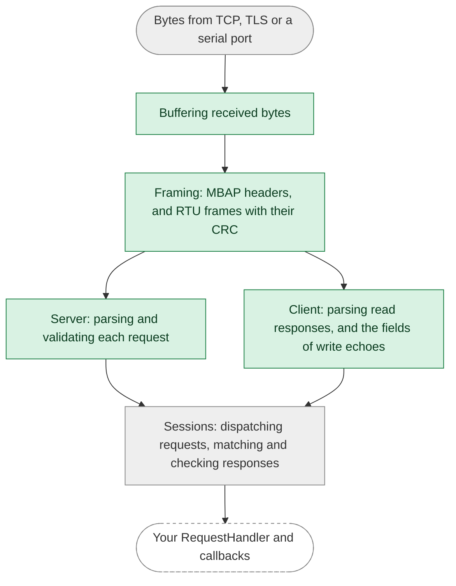

This page describes how the library defends against malformed or malicious input, which of those defenses are proven
rather than just enforced, and what they don't cover. For how to report a vulnerability, and for how we manage
dependencies, see the [security policy](https://github.com/stepfunc/rodbus/blob/main/SECURITY.md).

## At a glance

| Defense | How | Checked by |
|---|---|---|
| [Memory safety](#memory-safety) | `unsafe` code is forbidden in the Rust library | The compiler |
| [Restricted sources of panics](#restricting-sources-of-panics) | Panic-prone constructs are denied, with one documented exception | `clippy`, in CI |
| [Proven panic-free parsing](#proven-panic-free-parsing) | Framing, request validation, and the parsing of response values can't panic, whatever bytes they receive | A link-time check, in CI |
| [Bounded resources](#bounded-resources) | Fixed-size buffers, bounded queues and sessions, and timeouts on handshakes and requests | Tests |
| [Protocol validation](#protocol-validation) | The Modbus specifications, with our reading of ambiguous clauses recorded | Tests, including property tests against models |
| [TLS](#tls) | rustls, mutual authentication, only the trust you configure, and optional role-based authorization | rustls, and tests |

## Memory safety

The Rust library is written in safe Rust: `unsafe` code is forbidden, which the compiler enforces. This covers the
library itself, not the crates it depends on, such as Tokio, rustls and the serial port crate. The bindings for C,
C++, .NET and Java are generated from an API schema, with a thin layer of hand-written adapters. They use `unsafe` at
the boundary with the other language, where they trust the pointers and handles your application passes in. Modbus
parsing is implemented in the safe Rust library, and the bindings adapt its values and iterators for your callbacks.

## Restricting sources of panics

An uncaught panic can end a task, a thread or, depending on how the application is built, the whole process, so a
panic that input can trigger is a denial-of-service vulnerability. CI runs `clippy` on the library with these lints denied:

* `unwrap` and `expect` on `Option` and `Result`
* indexing and slicing that can go out of bounds
* arithmetic that can overflow, underflow or divide by zero
* `panic!`, `unreachable!`, `todo!` and `unimplemented!`
* slicing a string at a position that may not be a character boundary

Tests may unwrap, panic and index. In the library itself, an exception to these lints is allowed only where it can't
cause the first panic:

* the invariant that makes it safe is local and trivially true, or
* it can only fire after another panic has already happened.

There is one such exception today: locking a request handler's mutex expects that the mutex isn't poisoned, which can
only happen if an earlier panic, in the library or in your code, happened while it was held. Exceptions carry a narrow `#[expect]` with a stated reason, and
`#[allow]` is denied, so an exception can't be added without being visible in the code.

## Proven panic-free parsing

The lints restrict panics in our own code, but a call into the standard library or a dependency can still panic. So
CI also proves, at link time, that the following steps can't panic **for any input**: framing, validating requests
with a supported function code, decoding the values in read responses, and decoding the fields of write echoes:



The green steps are proven panic-free. The asynchronous session code and I/O around them aren't part of the proof,
shown in gray, and neither is the client's handling of a response's function code and exceptions, or comparing a
write's echo with the request. Your own handlers are code we can't check.

<details>
<summary>How the proof works</summary>

The proof uses the [no-panic](https://github.com/dtolnay/no-panic) technique. The entry points of the green steps are
compiled so that a reachable panic, in them or in anything they call, leaves a reference to a symbol that doesn't
exist, and the optimizer removes the reference only if it can prove that no path to a panic exists. A test harness
calls them with input read at run time, so the optimizer can't specialize them to known values. If the test binary
links, these steps can't panic.

</details>

:::tip Run it yourself
The `no-panic` CI job runs for every pull request and release tag, building the test binary in release mode with
link-time optimization on a pinned toolchain. To run it locally:

```
RUSTFLAGS="--cfg rodbus_no_panic" CARGO_PROFILE_RELEASE_LTO=thin CARGO_PROFILE_RELEASE_CODEGEN_UNITS=1 \
  cargo +1.99 test -p rodbus --lib --release --no-run
```
:::

:::note What the proof doesn't cover
The asynchronous session code that dispatches requests and matches and checks responses, including the client's
handling of function codes and exceptions and its comparison of write echoes, I/O and logging, and code you supply, such as a `RequestHandler`, an `AuthorizationHandler` or a callback.
:::

## Additional compile-time checks

Some lints that don't concern panics are denied because the bugs they catch are silent:

* `as` conversions, which can truncate or change sign without warning. Conversions use `From`, or `TryFrom` with the
  failure handled.
* comparing floating-point numbers for equality, and float literals that lose precision
* binding a value to `_` without naming its type, and discarding a future that way at all

## Bounded resources

Each connection's receive buffer is allocated once, at a fixed size that holds the largest Modbus frame, and each
frame's PDU is copied into a fixed-size buffer, so receiving and framing make no heap allocations per frame.

| Resource | Bound | Past the bound |
|---|---|---|
| Client request queue | `max_queued_requests` (at least 1) | `Channel` waits for room; the C, C++, .NET and Java bindings refuse the request at once |
| Client request | The request's timeout, which starts just before the request is sent and covers both sending it and waiting for its response. Time waiting for room in the queue, in the queue, or while the request is formatted, isn't counted | If sending runs out of time, the request fails with an I/O error and the connection is closed. If the response doesn't arrive in time, the request fails with `ResponseTimeout`, and after `max_response_timeouts` such timeouts in a row (if set), the connection is closed |
| TLS handshake, client and server | 5 seconds | The connection is closed; the client retries with its retry strategy |
| Server sessions | `max_sessions` (at least 1) | A new session replaces the oldest one, whose task is stopped even if it is blocked sending |

The server applies the [address filter](../api/server/tcp_server.mdx) before a TLS handshake starts, and completes the
handshake before the connection counts as a session, so a peer that never completes a handshake can't take a
session's place. An error from accepting a connection doesn't stop the server: it retries at once after an interrupted call or an
error that belongs to a single connection, and pauses for a second after other errors, such as running out of file
descriptors.

## Protocol validation

The library implements its function codes from the MODBUS Application Protocol Specification V1.1b3, the Modbus over
Serial Line Specification V1.02 and the Modbus Messaging on TCP/IP Implementation Guide V1.0b. Where a clause is
ambiguous, we record how we read it. Examples of how it validates the frames it receives intact:

| Behavior | Follows |
|---|---|
| A client accepts a response only from the unit it asked: over TCP the transaction and unit identifiers must match its request, over a serial line the address. Other frames are ignored and the request's timeout keeps running. On TCP, checking the unit identifier is our reading: the guide has a directly connected server's identifier discarded, and such a server echoes the request's | TCP/IP Implementation Guide 3.1.3, 4.4.1.3; Serial Line 2.1, 2.3, 2.4.1 |
| A server ignores every request addressed to a unit it doesn't serve, so it never answers for another device on a shared line | Serial Line 2.3, 2.4.2, 2.5.1.1 |
| For a request with a supported function code addressed to a unit it serves, other than a broadcast, a server checks a request's length, quantity, byte count and values before its address: invalid values are answered with exception 03 (Illegal Data Value), and a range past the end of the address space with 02 (Illegal Data Address), without calling your handler | Application Protocol 6.1-6.6, 6.11, 6.12, 7 |
| The quantity limits (2000 coils or discrete inputs and 125 registers per read, 1968 coils and 123 registers per write) are enforced by the server on the requests it receives and by the client on the requests it sends | Application Protocol 6.1-6.4, 6.11, 6.12 |
| A client checks every response against its request before completing it: the function code, and as each response requires, the byte count, the length and the echo of a write | Application Protocol 6.1-6.6, 6.11, 6.12, 7 |
| On a serial line, a frame is accepted only with a valid CRC. Bytes that can't start a valid frame, by their function code, length or CRC, are dropped one at a time until one does, and a partial frame is dropped once the line has been silent for 3.5 character times or 50 ms, whichever is longer. Neither ends the session | Serial Line 2.5.1.1, 2.5.1.2 |
| On a serial line, the library waits 3.5 character times (1.75 ms above 19200 baud) before it transmits, counted from the latest of opening the port, its last completed read and the estimated end of its own last transmission. These are times seen by the host, and the end of a transmission is estimated from the baud rate, so buffering in a driver or adapter can still shorten the silence on the line | Serial Line 2.5.1.1 |
| A broadcast (address 0 on a serial line) is executed by the server only for writes, and never answered | Serial Line 2.1 |

Property tests check the request parser, the response handling, the frame readers, and client and server sessions
against independent models of these specifications and of the library's documented behavior, for generated requests,
responses, chunkings and corruptions.

## TLS

TLS is implemented with [rustls](https://github.com/rustls/rustls), not OpenSSL, and is mutually authenticated.

* In `CertificateMode::AuthorityBased`, the library trusts only the certificate authorities in the file you
  configure: it never loads the operating system's trust store or any built-in set of roots. A client configured
  without a server name skips matching the name, but the certificate must still pass every other check against those
  authorities.
* In `CertificateMode::SelfSigned`, the peer's certificate is compared byte for byte with the one you configure, and
  certificate chains are rejected.
* The minimum TLS version you configure is enforced on both sides.
* A Modbus Security server with an `AuthorizationHandler` requires the client certificate to carry exactly one role
  (the Modbus role extension), and closes the connection after the handshake otherwise. Every valid request is
  passed to your handler with that role before it is processed, and a denied request is answered with exception 01
  (Illegal Function). Without an `AuthorizationHandler`, every authenticated client may make every request.

See [TLS](../api/tls.mdx) for configuration.

## What this doesn't cover

* **Plain TCP and serial lines have no authentication.** Anyone who can reach the port or the bus can send requests.
  Use TLS with authorization, or restrict who can connect to a TCP server with its address filter and your network.
* **Slow or stalled peers.** A server session waits on its peer without a deadline: a session that stops reading or
  sending holds its place until it closes, the server shuts down, or a newer connection replaces it. TLS handshakes
  are performed one at a time, so a peer that stalls its handshake delays the next connections by up to the 5 second
  timeout. Establishing a TCP connection relies on the operating system's connect timeout.
* **Serial line noise.** RTU frames have no start marker, so after noise the library finds the next frame by its
  function code, length and CRC. A frame that arrives before the line goes silent, behind noise that announces a
  longer frame, is dropped along with it. And like any receiver that checks a 16-bit CRC, the library can't tell noise
  from a frame whose CRC happens to match.
* **Logging.** With protocol decoding enabled, the library logs the bytes and values it sends and receives, including
  traffic that TLS protects on the wire. Decide where those logs go accordingly.
* **Your code.** Request handlers, authorization handlers and callbacks are called by the library, which validates
  what reaches them but can't check what they do.
* **Dependencies.** The guarantees on this page are about rodbus's own code. Tokio, rustls and the serial port crate
  are separate projects; see the [security policy](https://github.com/stepfunc/rodbus/blob/main/SECURITY.md) for
  how we track their advisories.
* **The bindings' boundary.** The C, C++, .NET and Java bindings trust the pointers and handles your application
  passes in.
* **Availability under load.** The bounds above limit what one peer can hold, but a server under a flood of
  connections or requests still spends time on each.
