import Tabs from '@theme/Tabs';
import TabItem from '@theme/TabItem';

The library is written in safe Rust, and the steps that parse frames, answer requests and format what it sends are
proven not to panic, for any input. This page describes how that and the library's other defenses are checked, and
what they don't cover. For how to report a vulnerability, and for how we manage
dependencies, see the [security policy](https://github.com/stepfunc/rodbus/blob/main/SECURITY.md).

## At a glance

| Defense | How | Checked by |
|---|---|---|
| [Memory safety](#memory-safety) | `unsafe` code is forbidden in the Rust library | The compiler |
| [Panic freedom](#panic-freedom) | Parsing frames, answering requests and formatting what is sent are proven not to panic; lints deny common sources of panics throughout the library | A link-time proof and `clippy`, in CI |
| [Bounded resources](#bounded-resources) | Fixed-size buffers, no allocation while answering a request, bounded queues and sessions, and timeouts on handshakes and requests | Tests |
| [TLS](#tls) | rustls, mutual authentication, only the trust you configure, and optional role-based authorization | rustls, and tests |

## Memory safety

The Rust library is written in safe Rust: `unsafe` code is forbidden, which the compiler enforces. This covers the
library itself, not the crates it depends on, such as Tokio, rustls and the serial port crate. The bindings for C,
C++, .NET and Java are generated from an API schema, with a thin layer of hand-written adapters. They use `unsafe` at
the boundary with the other language, where they trust the pointers and handles your application passes in. Modbus
parsing is implemented in the safe Rust library, and the bindings adapt its values and iterators for your callbacks.

## Panic freedom

An uncaught panic can end a task, a thread or, depending on how the application is built, the whole process, so a
panic that input can trigger is a denial-of-service vulnerability. A proof rules out panics in the steps that parse
what the library receives and format what it sends, and lints that deny common sources of panics apply throughout
the library.

### Proven for any input

CI proves, at link time, that the following steps can't panic **for any input**, including in the standard library
and dependency code they call:

* receiving: framing, validating requests with a supported function code, decoding the values in read responses, and
  decoding the fields of write echoes
* sending: formatting each request, answering each request (executing a write, reading values, or replying with an
  exception), and framing what is sent

<Tabs
groupId="role"
defaultValue="client"
values={[
{label: 'Client', value: 'client'},
{label: 'Server', value: 'server'},
]}>
<TabItem value="client">


</TabItem>
<TabItem value="server">



</TabItem>
</Tabs>

```mermaid
flowchart TB
    subgraph receiving [Receiving]
        rx(["Bytes from TCP, TLS or a serial port"]):::outside
        rframe["Framing: buffering bytes into MBAP frames, or RTU frames with their CRC checked"]:::proven
        rpdu["Parsing and validating each request"]:::proven
    end
    subgraph sending [Sending]
        tx(["Bytes to TCP, TLS or a serial port"]):::outside
        sframe["Framing: MBAP headers, or RTU frames with their CRC"]:::proven
        spdu["Answering each request: executing a write, reading values, or replying with an exception"]:::proven
    end
    session["Session: dispatching each request to the handler for its unit"]:::outside
    user(["Your RequestHandler"]):::user
    rx --> rframe --> rpdu --> session
    tx <--> sframe
    sframe <--> spdu
    spdu <--> session
    session --- user
    %% each sending link is listed from the step above to the one below, so the column rises; only its upper arrowhead is drawn
    linkStyle 3,4,5 marker-end:none
    classDef proven fill:#d9f2e3,stroke:#1b7f45,color:#0b3d20
    classDef outside fill:#eeeeee,stroke:#888888,color:#333333
    classDef user fill:#ffffff,stroke:#888888,stroke-dasharray:4 4,color:#333333
```

The green steps are proven panic-free. The asynchronous session code and I/O around them aren't part of the proof,
shown in gray, and neither is the client's handling of a response's function code and exceptions, or comparing a
write's echo with the request. Your own handlers are code we can't check: when the server answers a request, the
proof covers everything around the calls to your handler, assuming that they return.

<details>
<summary>How the proof works</summary>

The proof uses the [no-panic](https://github.com/dtolnay/no-panic) technique. The entry points of the green steps are
compiled so that a reachable panic, in them or in anything they call, leaves a reference to a symbol that doesn't
exist, and the optimizer removes the reference only if it can prove that no path to a panic exists. A test harness
calls them with input read at run time, so the optimizer can't specialize them to known values. If the test binary
links, these steps can't panic.

Generic code is checked for each type the library uses it with. Where a step calls code the library doesn't own, such
as your `RequestHandler` or the logging of a frame, the harness passes a stand-in, so the proof covers the step around
the call but not the call itself. The proof is of the release build. A debug build also panics on arithmetic overflow:
a lint keeps the library's own code to arithmetic that reports, saturates or wraps instead, but the crates it
depends on aren't held to that.

</details>

:::tip Run it yourself
The `no-panic` CI job runs for every pull request and release tag, building the test binary in release mode with
link-time optimization on a pinned toolchain. To run it locally:

```
RUSTFLAGS="--cfg rodbus_no_panic" CARGO_PROFILE_RELEASE_LTO=thin CARGO_PROFILE_RELEASE_CODEGEN_UNITS=1 \
  cargo +1.99 test -p rodbus --lib --release --no-run
```
:::

:::note What the proof doesn't cover
The asynchronous session code that dispatches requests and matches and checks responses, including the client's
handling of function codes and exceptions and its comparison of write echoes, I/O and logging, and code you supply, such as a `RequestHandler`, an `AuthorizationHandler` or a callback.
:::

### Denied throughout the library

Each of these `clippy` lints, denied in CI throughout the library, shows only that one kind of construct isn't used.
None of them proves that the code can't panic, but together they make panics less likely in the code the proof
doesn't cover, and they help keep the code it does cover in a form the proof can check:

* `unwrap` and `expect` on `Option` and `Result`
* indexing and slicing that can go out of bounds
* arithmetic that can overflow, underflow or divide by zero
* `panic!`, `unreachable!`, `todo!` and `unimplemented!`
* slicing a string at a position that may not be a character boundary
* standard library methods, macros and types that can panic in ways the lints above don't see, such as `split_at` and
  `copy_from_slice` on a length that doesn't fit, the `assert!` macros, and `RefCell`

Tests may unwrap, panic and index. In the library itself, an exception to these lints is allowed only where it can't
cause the first panic:

* the invariant that makes it safe is local and trivially true, or
* it can only fire after another panic has already happened.

Apart from checks that run at compile time, such as an `assert!` in a `const` block, there is one such exception
today: locking a request handler's mutex expects that the mutex isn't poisoned, which can only happen if an earlier
panic, in the library or in your code, happened while it was held. Exceptions carry a narrow `#[expect]` with a stated
reason, and `#[allow]` is denied, so an exception can't be added without being visible in the code.

## Bounded resources

Each connection's buffers are allocated once, at a fixed size that holds the largest Modbus frame. A server receives,
parses and answers each request without allocating in the library's own code: the request's values are read where
they were received, and the reply is formatted into a fixed-size buffer. Logging, when enabled, and the layers below
the library, such as Tokio and rustls, may allocate.

| Resource | Bound | Past the bound |
|---|---|---|
| Client request queue | `max_queued_requests` (at least 1) | `Channel` waits for room; the C, C++, .NET and Java bindings refuse the request at once |
| Client request | The request's timeout, which starts just before the request is sent and covers both sending it and waiting for its response. Time waiting for room in the queue, in the queue, or while the request is formatted, isn't counted | If sending runs out of time, the request fails with an I/O error and the connection is closed. If the response doesn't arrive in time, the request fails with `ResponseTimeout`, and after `max_response_timeouts` such timeouts in a row (if set), the connection is closed |
| TLS handshake, client and server | 5 seconds | The connection is closed; the client retries with its retry strategy |
| Server sessions | `max_sessions` (at least 1) | A new session replaces the oldest one, whose task is stopped even if it is blocked sending |

The server applies the [address filter](../api/server/tcp_server.mdx) before a TLS handshake starts, and completes the
handshake before the connection counts as a session, so a peer that never completes a handshake can't take a
session's place.

## TLS

TLS is implemented with [rustls](https://github.com/rustls/rustls), not OpenSSL, and is mutually authenticated.

* In `CertificateMode::AuthorityBased`, the library trusts only the certificate authorities in the file you
  configure: it never loads the operating system's trust store or any built-in set of roots. A client configured
  without a server name skips matching the name, but the certificate must still pass every other check against those
  authorities.
* In `CertificateMode::SelfSigned`, the peer's certificate is compared byte for byte with the one you configure, and
  certificate chains are rejected.
* The minimum TLS version you configure is enforced on both sides.
* A Modbus Security server with an `AuthorizationHandler` requires the client certificate to carry exactly one role
  (the Modbus role extension) without a NUL character, and closes the connection after the handshake otherwise. Every valid request is
  passed to your handler with that role before it is processed, and a denied request is answered with exception 01
  (Illegal Function). Without an `AuthorizationHandler`, every authenticated client may make every request.

See [TLS](../api/tls.mdx) for configuration.

## What this doesn't cover

* **Logging.** With protocol decoding enabled, the library logs the bytes and values it sends and receives, including
  traffic that TLS protects on the wire. Decide where those logs go accordingly.
* **Your code.** Request handlers, authorization handlers and callbacks are called by the library, which validates
  what reaches them but can't check what they do.
* **Dependencies.** The guarantees on this page are about rodbus's own code. Tokio, rustls and the serial port crate
  are separate projects; see the [security policy](https://github.com/stepfunc/rodbus/blob/main/SECURITY.md) for
  how we track their advisories.
* **The bindings' boundary.** The C, C++, .NET and Java bindings trust the pointers and handles your application
  passes in.
