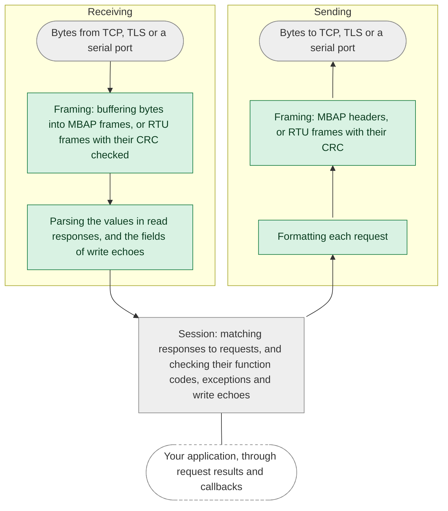
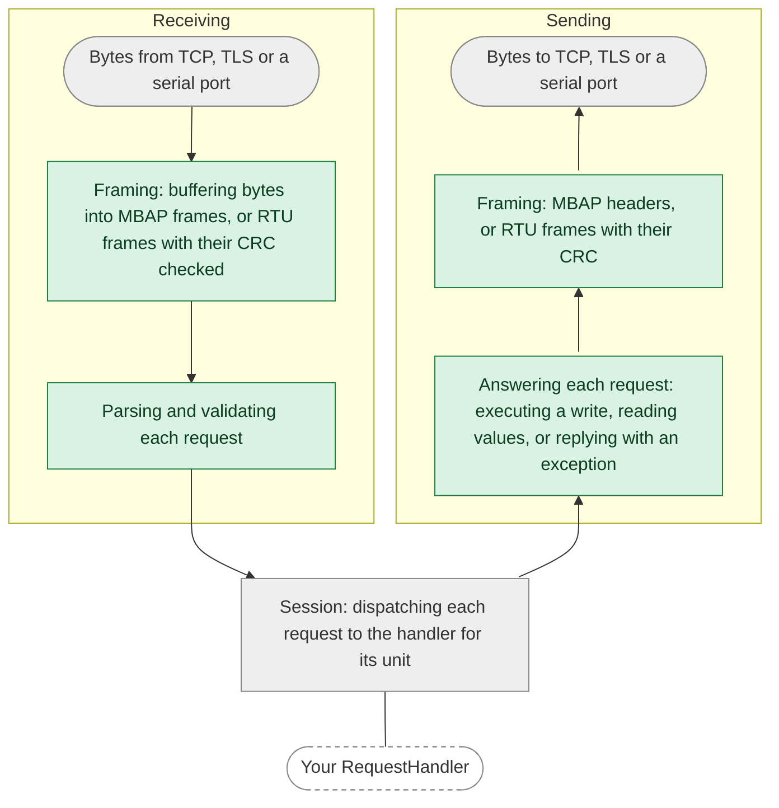

import Tabs from '@theme/Tabs';
import TabItem from '@theme/TabItem';

This page describes how the library defends against malformed or malicious input, and which of those defenses are
proven rather than just enforced. For how to report a vulnerability, and for how we manage dependencies, see the
[security policy](https://github.com/stepfunc/rodbus/blob/main/SECURITY.md).

## At a glance

| Defense | How | Checked by |
|---|---|---|
| [Memory safety](#memory-safety) | `unsafe` code is forbidden in the Rust library | The compiler |
| [Restricted sources of panics](#restricting-sources-of-panics) | Panic-prone constructs are denied, with documented exceptions | `clippy`, in CI |
| [Proven panic freedom](#proven-panic-freedom) | Parsing what is received, answering requests, and formatting and framing what is sent can't panic, whatever the input | A link-time check, in CI |
| [Bounded resources](#bounded-resources) | Fixed buffers, a bounded request queue and number of sessions, and timeouts | Tests |
| [Protocol validation](#protocol-validation) | The Modbus specifications | Property tests |
| [TLS](#tls) | rustls, mutual authentication, only the trust you configure, and optional role-based authorization | rustls, and tests |

## Memory safety

The Rust library is written in safe Rust: `unsafe` code is forbidden, which the compiler enforces. The bindings for C,
C++, .NET and Java are generated from an API schema, with a thin layer of hand-written adapters. They use `unsafe` at
the boundary with the other language, where they trust the pointers and handles your application passes in. Modbus
parsing is implemented in the safe Rust library, and the bindings adapt its values and iterators for your callbacks.

## Restricting sources of panics

A panic in Rust ends the task or thread it happens in, or the whole process in a build that aborts on panic, so a panic
that input can trigger is a denial-of-service vulnerability. CI runs `clippy` on the library with these lints denied:

* `unwrap` and `expect` on `Option` and `Result`
* indexing and slicing that can go out of bounds
* arithmetic that can overflow, underflow or divide by zero
* `panic!`, the `assert!` macros, `unreachable!`, `todo!` and `unimplemented!`
* standard library methods that panic on an argument out of range, such as `split_at` and `copy_from_slice`
* slicing a string at a position that may not be a character boundary
* `as` conversions, which can truncate or change sign without warning

Tests may unwrap and index. In the library, the few exceptions are places input can't reach, and each one states why.

## Proven panic freedom

The lints restrict panics in our own code, but a call into the standard library or a dependency can still panic. So
CI also proves, at link time, that the steps that parse what the library receives, answer requests, and format and
frame what it sends can't panic **for any input**, including in the standard library and dependency code they call.
Each diagram follows a request or response down from the bytes received, through the processing in your role, and back
up to the bytes sent:

<Tabs
groupId="role"
defaultValue="client"
values={[
{label: 'Client', value: 'client'},
{label: 'Server', value: 'server'},
]}>
<TabItem value="client">

</TabItem>
<TabItem value="server">

</TabItem>
</Tabs>

The green steps are proven panic-free. The gray ones are covered by the lints but not the proof, and your own handlers
are code we can't check.

How the proof works

The proof uses the [no-panic](https://github.com/dtolnay/no-panic) technique. Each function on the green path is
compiled so that a reachable panic leaves a reference to a symbol that doesn't exist, and the optimizer removes the
reference only if it can prove that no path to a panic exists. A test harness calls the functions with input read at
run time, so the optimizer can't specialize them to known values, and with output buffers of every size from empty to
the largest Modbus frame. If the test binary links, these functions can't panic.

Where a step calls code the library doesn't own, such as your `RequestHandler` or logging, the harness passes a
stand-in, so the proof covers the step around the call but not the call itself. The proof is checked twice: once as a
release build, and once with overflow checks on, as in a debug build, so arithmetic overflow can't panic in either.

The check fails closed: if any of these functions could panic, the test binary doesn't link, and the error names the
function. We verified this on both the receiving and the sending path by temporarily adding panics to these
functions; each one broke the link.

The `no-panic` job in [CI](https://github.com/stepfunc/rodbus/blob/main/.github/workflows/ci.yml) runs this check on
every pull request and release tag, with link-time optimization on a pinned toolchain, both with and without overflow
checks; the workflow has the exact commands.

:::note What the proof doesn't cover
The asynchronous session code that dispatches requests and matches and checks responses, I/O and logging, and code you
supply, such as a `RequestHandler`, an `AuthorizationHandler` or a callback.
:::

## Bounded resources

Each connection's buffers are allocated once, at a fixed size that holds the largest Modbus frame, and a server parses
and answers each request in place, in those buffers. The client queues a bounded number of
requests and gives each one a response timeout, and the server serves a bounded number of sessions and gives each TLS
handshake a fixed time to complete.

## Protocol validation

The library follows the Modbus specifications. A server checks each request before passing it to your handler, and
answers an invalid one with the exception the standard prescribes. A client checks every response against its request
before completing it, and on a serial line, a frame is accepted only with a valid CRC. Property tests check the
parsers, the frame readers, and the client and server sessions against independent models of the specifications.

## TLS

TLS is implemented with [rustls](https://github.com/rustls/rustls), not OpenSSL, and is mutually authenticated.

* In `CertificateMode::AuthorityBased`, the library trusts only the certificate authorities you configure: it never
  loads the operating system's trust store or any built-in set of roots.
* In `CertificateMode::SelfSigned`, the peer's certificate is compared byte for byte with the one you configure, and
  certificate chains are rejected.
* A Modbus Security server asks your `AuthorizationHandler` about every well-formed request, with the role from the
  client's certificate, before processing it.

See [TLS](../api/tls.mdx) for configuration.

:::note
With protocol decoding enabled, the library logs the bytes and values it sends and receives, including traffic that TLS
protects on the wire. Decide where those logs go accordingly.
:::
