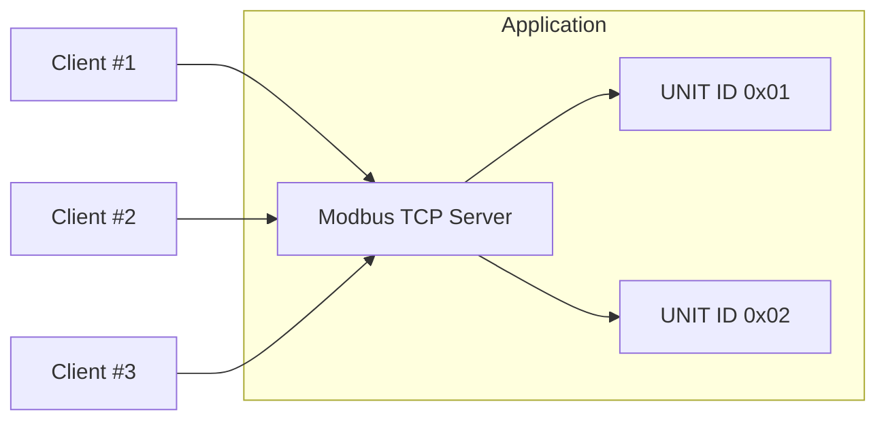

import Tabs from '@theme/Tabs';
import TabItem from '@theme/TabItem';

Each TCP server processes requests for one or more unit IDs from multiple external clients.



The `DeviceMap` class (`ServerHandlerMap` in Rust) associates each unit ID with the data and write handling you provide to
clients. The server doesn't reply to a request for a unit ID that isn't in the map.

## Creating a server

First build a `DeviceMap` for each unit ID the server must support. Then use the `create_tcp` static method of the `Server`
class (`spawn_tcp_server_task` in Rust). The server starts listening immediately, and creation fails if it can't bind the port,
for example when another process already uses it.

You also choose the local address to listen on, such as:

* `127.0.0.1` for localhost only
* `0.0.0.0` for all adapters
* The IP address of a particular adapter

The other arguments are the `AddressFilter`, the maximum number of sessions and the decode level; the API docs describe each one.
The `AddressFilter` limits which client IP addresses may connect; `AddressFilter.any()` allows all of them, and the filter also
accepts IPv4 wildcards such as `192.168.0.*`.

When a new connection would exceed the maximum number of sessions, the server closes the oldest session to make room.

<Tabs
groupId="language"
defaultValue="Rust"
values={[
{label: 'Rust', value: 'Rust'},
{label: 'C', value: 'C'},
{label: 'C++', value: 'C++'},
{label: 'Java', value: 'Java'},
{label: 'C#', value: 'C#'},
]}>
<TabItem value="Rust">

```rust
{{#include ../examples/server/src/main.rs:handler_map_create}}

{{#include ../examples/server/src/main.rs:tcp_server_create}}
```

</TabItem>
<TabItem value="C">

```c
{{#include ../ffi/bindings/c/server_example.c:device_map_init}}

{{#include ../ffi/bindings/c/server_example.c:tcp_server_create}}
```

</TabItem>
<TabItem value="C++">

```cpp
{{#include ../ffi/bindings/c/server_example.cpp:device_map_init}}

{{#include ../ffi/bindings/c/server_example.cpp:tcp_server_create}}
```

</TabItem>
<TabItem value="Java">

```java
{{#include ../ffi/bindings/java/examples/src/main/java/io/stepfunc/rodbus/examples/ServerExample.java:device_map_init}}

{{#include ../ffi/bindings/java/examples/src/main/java/io/stepfunc/rodbus/examples/ServerExample.java:tcp_server_create}}
```

</TabItem>
<TabItem value="C#">

```csharp
{{#include ../ffi/bindings/dotnet/examples/server/Program.cs:device_map_init}}

{{#include ../ffi/bindings/dotnet/examples/server/Program.cs:tcp_server_create}}
```

</TabItem>
</Tabs>

In Rust, the `wrap()` method of `RequestHandler` moves your handler into the `Arc<Mutex>` that the `ServerHandlerMap` holds.
