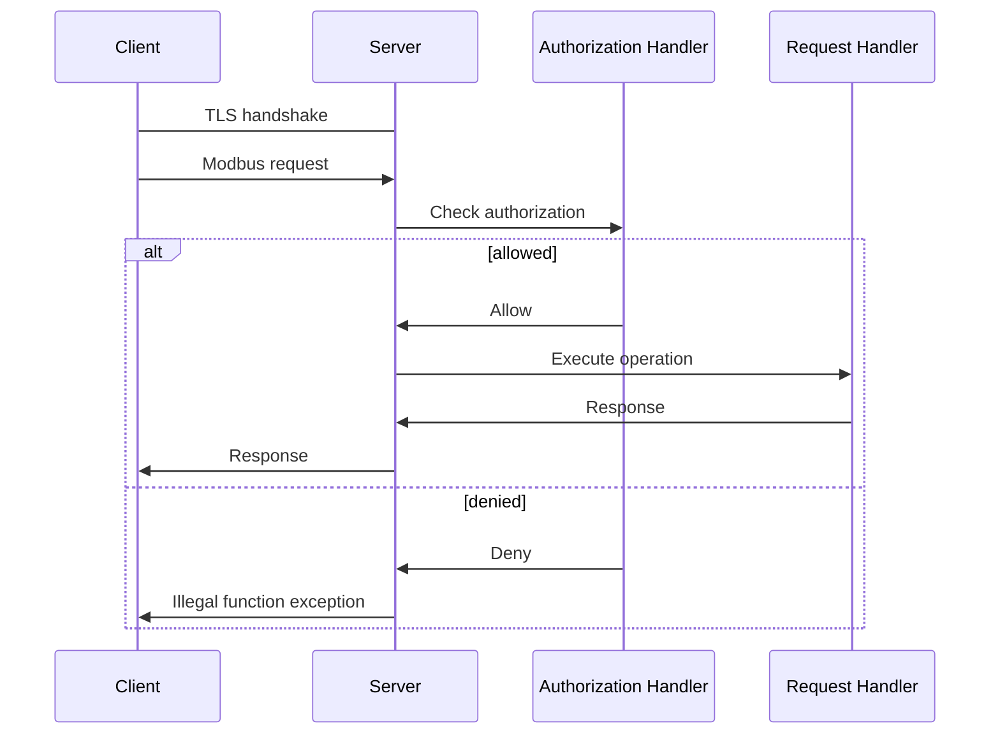

import Tabs from '@theme/Tabs';
import TabItem from '@theme/TabItem';

Clients and servers can use TLS for encryption and authentication. The library uses
[rustls](https://github.com/rustls/rustls) instead of OpenSSL:

* **More secure and reliable:** rustls is written in memory-safe Rust, which rules out the buffer overflows and
  use-after-free bugs behind many of OpenSSL's most serious vulnerabilities, such as Heartbleed, and the crashes they
  cause. It only implements TLS 1.2 and 1.3 with modern cipher suites, so there are no legacy protocols or weak options
  to leave enabled by mistake.
* **The future:** security agencies such as CISA and the NSA urge moving critical software to memory-safe languages, and
  rustls is backed by the Internet Security Research Group, the organization behind Let's Encrypt, as part of its effort
  to do that for the internet's infrastructure. With the AWS-LC cryptography provider, it already supports post-quantum
  key exchange.

## Modbus security

[Modbus Security](https://modbus.org/docs/MB-TCP-Security-v21_2018-07-24.pdf) runs Modbus TCP inside TLS, and adds
role-based authorization on the server. The IANA reserved port for Modbus Security is 802.

The client's certificate carries its role in an X.509v3 extension with OID `1.3.6.1.4.1.50316.802.1`, as an
`ASN1:UTF8String`. The role is an arbitrary string that your server uses to authorize requests. For example, a client
with the `historian` role might only be allowed to read a certain range of values, while a client with the `operator`
role might be able to write coils and registers.



A Modbus Security server takes an `AuthorizationHandler`, with a method for each type of request. Each method receives
the destination unit ID, the requested range or index, and the client's role, and returns `Allow` or `Deny`. An allowed
request goes on to your request handler; a denied one is answered with an Illegal Function exception. In Rust, a method
you don't implement denies the request.

The client's certificate must carry exactly one role, without a NUL character. Otherwise, the server closes the
connection after the handshake.

## Supported features

- TLS v1.2 and v1.3
- The cipher suites, key exchange groups, and signature schemes are the rustls defaults for the cryptography provider: [ring](https://crates.io/crates/ring) or [aws-lc-rs](https://crates.io/crates/aws-lc-rs) in Rust, selected by the `tls` (the default) or `tls-aws-lc` feature, and aws-lc-rs in the prebuilt bindings on every platform.
- Server name validation through the Subject Alternative Name (SAN) extension or the Common Name.
- Self-signed certificates (with a special configuration).

## Configuration

Configure TLS with `TlsClientConfig` or `TlsServerConfig`: the trusted peer certificate(s), your certificate and private
key, the expected server name (client only), the minimum TLS version, and the certificate mode described below. In Rust,
the client's constructor chooses the mode: `full_pki` for `AuthorityBased`, `self_signed` for `SelfSigned`. The API
documentation describes each field.

:::warning
In the bindings, pass an empty string, not `null`, as the password of a private key that isn't encrypted.
:::

### Name validation

In `AuthorityBased` mode, a client checks that the server's certificate is valid for the name you configure. The name is
matched against the certificate's Subject Alternative Name (SAN) entries, ignoring case, and wildcards are allowed. An IP
address is matched against the SAN's IP entries. If the certificate has no SAN, its Common Name must match exactly.

A client configured without a name (`None` in Rust, or `*` with `allow_server_name_wildcard` in the bindings) skips the
name check, but the server's certificate must still chain to a configured authority. The server doesn't check the
client's name.

:::tip
New certificates should always include the SAN extension. Performing name verification using the `Common Name`
is still secure, but it is deprecated for new use cases.
:::

### Private key encryption

Private keys are PEM files in PKCS#1 or PKCS#8 format. An encrypted key must be PKCS#8
(`BEGIN ENCRYPTED PRIVATE KEY`) using scrypt or PBKDF2 with AES-CBC. Legacy SHA-1 and DES/3DES encryption isn't
supported. The OpenSSL [pkcs8 command](https://www.openssl.org/docs/man1.1.1/man1/openssl-pkcs8.html) can convert a key.

:::tip
Encrypting private keys for use with TLS rarely addresses a meaningful threat model. Encrypting a private key and storing
the password in a configuration file is equivalent to locking your doors and leaving the key under the doormat.
:::

### Certificate mode

The certificate mode determines how the presented peer certificate is validated.

### Authority-based

The `AuthorityBased` mode, the default in the bindings, uses the default `rustls` implementation to check the presented
chain of certificates and verify that the root certificate of the chain is one of those provided in the `peer_cert_path`
file.

### Self-signed

The `SelfSigned` mode validates that:

* Only a single certificate is presented
* It is a byte-for-byte match of the one specified in `peer_cert_path`
* `NotBefore` and `NotAfter` time fields are valid for the current time

### Generating certificates

The following OpenSSL commands are provided for testing purposes only. Real systems will use some kind of specialized CA software for certificate procurement.

### Full CA chain

- Generate the root CA certificate:

  ```bash
  openssl req \
    -x509 -newkey rsa:4096 -keyout ./ca_key.pem -out ./ca_cert.pem \
    -subj "/C=US/ST=Oregon/L=Bend/O=Test/CN=DO NOT USE" -nodes -days 3650
  ```
- Generate the client CSR:

  ```bash
  openssl req \
    -new -newkey rsa:4096 -keyout ./client_key.pem -out ./client_csr.pem \
    -subj "/C=US/ST=Oregon/L=Bend/O=Test/CN=DO NOT USE" \
    -addext "1.3.6.1.4.1.50316.802.1=ASN1:UTF8String:operator" \
    -nodes -days 365
  ```
- Generate the client certificate:

  ```bash
  openssl x509 \
    -req -days 365 -in ./client_csr.pem \
    -extfile <(printf "1.3.6.1.4.1.50316.802.1=ASN1:UTF8String:operator") \
    -CA ./ca_cert.pem -CAkey ./ca_key.pem -set_serial 1 \
    -out ./client_cert.pem -sha256
  ```
- Generate the server CSR:

  ```bash
  openssl req \
    -new -newkey rsa:4096 -keyout ./server_key.pem -out ./server_csr.pem \
    -subj "/C=US/ST=Oregon/L=Bend/O=Test/CN=DO NOT USE" \
    -addext "subjectAltName=DNS:test.com" -nodes -days 365
  ```
- Generate the server certificate:

  ```bash
  openssl x509 \
    -req -days 365 -in ./server_csr.pem \
    -extfile <(printf "subjectAltName=DNS:test.com") -CA ./ca_cert.pem \
    -CAkey ./ca_key.pem -set_serial 2 -out ./server_cert.pem -sha256
  ```

### Self-signed certificate

- Generate the client certificate:

  ```bash
  openssl req \
    -x509 -newkey rsa:4096 -keyout ./client_key.pem -out ./client_cert.pem \
    -subj "/C=US/ST=Oregon/L=Bend/O=Test/CN=DO NOT USE" \
    -addext "1.3.6.1.4.1.50316.802.1=ASN1:UTF8String:operator" \
    -nodes -days 365
  ```
- Generate the server certificate:

  ```bash
  openssl req \
    -x509 -newkey rsa:4096 -keyout ./server_key.pem -out ./server_cert.pem \
    -subj "/C=US/ST=Oregon/L=Bend/O=Test/CN=DO NOT USE" \
    -addext "subjectAltName=DNS:test.com" -nodes -days 365
  ```
